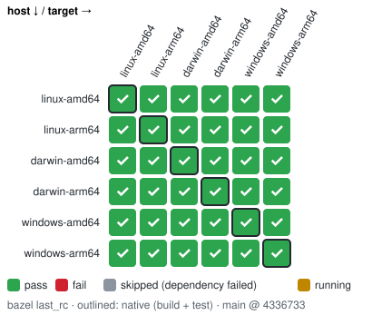

# Tracy for Bazel: from source, hermetic, cross-compiled

This repository is a **staging area for a Bazel module that builds the
[Tracy](https://github.com/wolfpld/tracy) frame profiler (v0.15.0) from
source**, together with the dependency modules it needs that are not yet in
the [Bazel Central Registry](https://registry.bazel.build). It holds a local
Bazel registry (`bazel_registry.json` + `modules/`), consumer-style tests, and
CI that builds everything natively and cross-compiles it for every
{Linux, macOS, Windows} × {amd64, arm64} pair with a hermetic LLVM toolchain.

The layout and CI follow
[`qt_bazel_workspace`](https://github.com/asymingt/qt_bazel_workspace). The
plan and phasing are in [`design/`](design/OVERVIEW.md).

| :warning: WARNING           |
|:----------------------------|
| This repo was generated by an agentic coding model, and is undergoing |
| active human review and testing. Use at your own risk.                |

## Status

| Phase | Scope | State |
| --- | --- | --- |
| [1](design/PHASE1.md) | Workspace + instrumentation client (`@tracy//:client`) | done |
| [2](design/PHASE2.md) | Server library + CLI tools (`tracy-capture`, `tracy-csvexport`, ...) | planned |
| [3](design/PHASE3.md) | GUI dependency modules | planned |
| [4](design/PHASE4.md) | GUI profiler (`tracy-profiler`) | planned |
| [5](design/PHASE5.md) | Hardening + BCR upstreaming | planned |

Latest `main` build, by host (rows) and target (columns), on Bazel 9.x and on
Bazel's latest release candidate. The diagonal is a native build plus the
tests; every other cell cross-compiles all targets for that platform.

| Bazel 9.x | Bazel `last_rc` |
| :---: | :---: |
| [](https://github.com/asymingt/tracy_bazel/actions/workflows/pull_request.yaml?query=branch%3Amain) | [](https://github.com/asymingt/tracy_bazel/actions/workflows/pull_request.yaml?query=branch%3Amain) |

## Try it now

Point Bazel (**9.0 or newer**) at the GitHub Pages mirror of this registry,
ahead of the BCR, in your `.bazelrc`:

```
common --registry=https://asymingt.github.io/tracy_bazel/
common --registry=https://bcr.bazel.build
```

Depend on the module:

```starlark
# MODULE.bazel
bazel_dep(name = "tracy", version = "0.15.0")
```

Instrument your code and link the client:

```starlark
# BUILD.bazel
cc_binary(
    name = "app",
    srcs = ["main.cc"],
    deps = ["@tracy//:client"],
)
```

```cpp
#include <tracy/Tracy.hpp>

void Update() {
  ZoneScoped;
  // ...
  FrameMark;
}
```

Profiling is **compiled out by default**, as it is upstream
(`TRACY_ENABLE=OFF`). Turn it on, and set any other client option, with
build settings:

```
bazel run //:app --@tracy//config:enable
bazel run //:app --@tracy//config:enable --@tracy//config:on_demand --@tracy//config:callstack=8
```

### Targets

| Target | Use |
| --- | --- |
| `@tracy//:client` | Static client. Link it into the one binary (or shared object) that owns the profiler. |
| `@tracy//:client_dynamic` + `@tracy//:client_shared` | Shared client. Depend on `:client_dynamic` and add `dynamic_deps = ["@tracy//:client_shared"]` to every `cc_binary`, `cc_test` and `cc_shared_library` that uses Tracy, so the whole process shares one profiler instance. Never mix with `:client`. |
| `@tracy//:headers` | The API and configuration only, so a library can be instrumented without choosing a client. The final link still needs one of the above. |

### Build settings (`--@tracy//config:<name>`)

Each upstream CMake option `TRACY_<NAME>` is the flag `<name>`, with the
upstream default (off):

`enable`, `on_demand`, `no_callstack`, `no_callstack_inlines`,
`only_localhost`, `no_broadcast`, `only_ipv4`, `no_code_transfer`,
`no_context_switch`, `no_exit`, `no_sampling`, `no_verify`,
`no_vsync_capture`, `no_frame_image`, `no_system_tracing`,
`patchable_nopsleds`, `delayed_init`, `manual_lifetime`, `fibers`,
`no_crash_handler`, `timer_fallback`, `disallow_hw_timer` (requires
`timer_fallback`), `symbol_offline_resolve`,
`libbacktrace_elf_dynload_support`, `ignore_memory_faults`,
`opengl_auto_calibration`, `verbose`, `no_internal_message`, `demangle`.

Plus `callstack=<depth>` (`TRACY_CALLSTACK`), and `platform_header="<path>"`
together with `platform_header_lib=<label>` (`TRACY_PLATFORM_HEADER`).

The settings become propagating compile definitions, so every translation unit
that includes Tracy sees the same configuration. Tracy also encodes the most
ABI-relevant options in its symbol names, so a mismatch fails at link time
rather than at run time.

Not provided, because they need libraries this module does not package:
`TRACY_LIBUNWIND_BACKTRACE`, `TRACY_DEBUGINFOD`, and ROCm (`TRACY_ROCPROF*`).

## Toolchain notes

The module itself is plain `rules_cc` and builds with any C++17 toolchain.
This workspace builds and tests it with the hermetic `@llvm` toolchain
(Clang + libc++; MinGW sysroot on Windows), with the same `@llvm` version and
patches as `qt_bazel_workspace` plus:

- `patches/llvm/windows_static_libcxxabi_no_exports.patch`: stops the static
  Windows libc++abi from carrying `dllexport` directives. Without it, every DLL
  re-exports `std::terminate`, `operator new`, ... and linking a second DLL
  against the first fails in lld with "std::terminate() was replaced".

With the MinGW toolchain, `cc_shared_library` names its output `lib<name>.so`
by default, which lld's `-l<name>` lookup does not find. Give Windows DLLs an
explicit `shared_lib_name` (see `tests/client/BUILD.bazel`).
`@tracy//:client_shared` already does this.

The `tracy` module carries one patch,
`modules/tracy/0.15.0/patches/mingw_arm64_cntvct.patch`. It lets the client
compile for Windows/arm64 with MinGW, where `_ReadStatusReg` and
`ARM64_CNTVCT_EL0` are only available under MSVC.

## Working on the registry

After editing anything under `modules/<name>/<version>/` (overlay or
patches), refresh the hashes and the `MODULE.bazel` copy, then restart Bazel
so it re-reads the local registry:

```
python3 tools/sync_overlay.py tracy 0.15.0   # or --all
bazel shutdown
```

## Licensing

Tracy is BSD-3-Clause, and so is its bundled libbacktrace. Both are declared
with `@rules_license` `license()` targets in the module.
